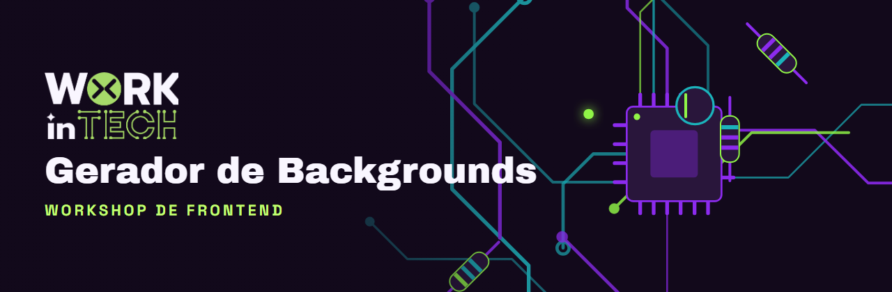
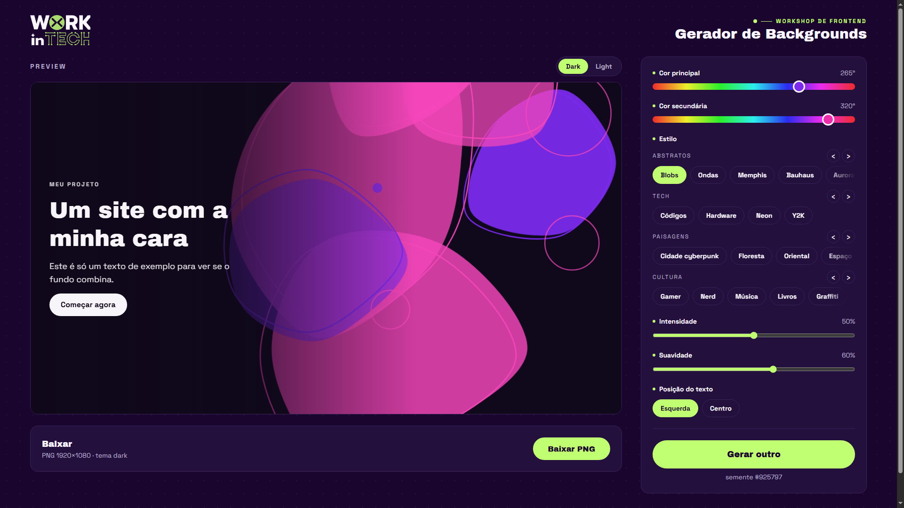
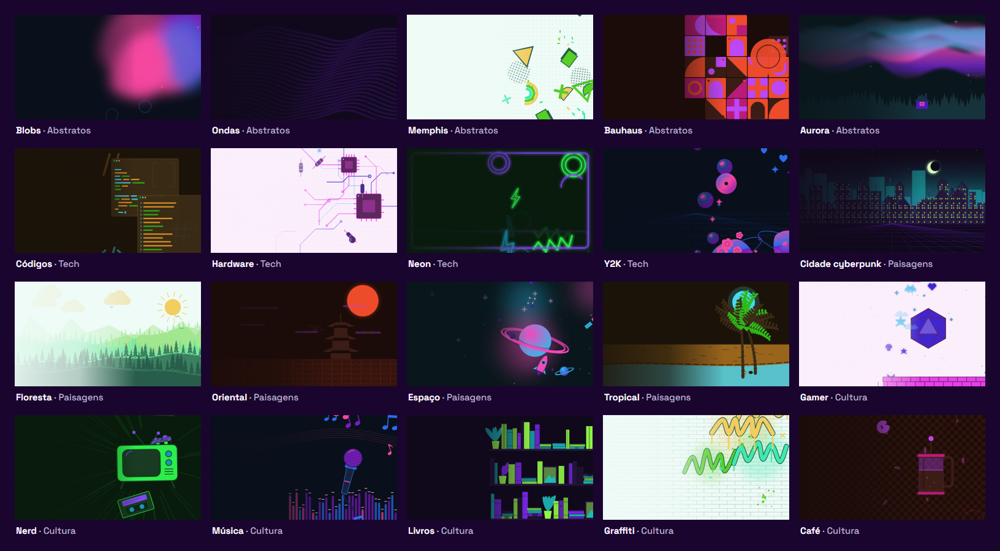

<p align="center">
  
</p>

<p align="center">
  <b>Crie um background único para o hero do seu site em poucos cliques.</b><br>
  Feito para o Workshop de Frontend da <b>Work in Tech</b> 💚
</p>

<p align="center">
  
  
  
  
</p>

---

## ✨ O que é

Cada aluno do workshop constrói um site, e todo site merece um **hero com personalidade**.
Aqui você escolhe as cores, o estilo, ajusta alguns controles e clica em **"Gerar outro"** até gostar.
Depois é só baixar o PNG e colocar no fundo do seu hero.

<p align="center">
  
</p>

## 🎨 20 estilos, em 4 grupos

<p align="center">
  
</p>

| Grupo | Estilos |
|---|---|
| **Abstratos** | Blobs · Ondas · Memphis · Bauhaus · Aurora |
| **Tech** | Códigos · Hardware · Neon · Y2K |
| **Paisagens** | Cidade cyberpunk · Floresta · Oriental · Espaço · Tropical |
| **Cultura** | Gamer · Nerd · Música · Livros · Graffiti · Café |

Cada estilo sorteia **variantes de cena** e **elementos extras**. A floresta pode ter pinheiros ou árvores
redondas; a música pode ter vinil, fita cassete, caixa de som ou microfone; o espaço pode ter anéis,
foguete, satélite, constelações... Dois alunos podem escolher exatamente as mesmas opções e mesmo
assim sair com fundos diferentes.

## 🕹️ Como usar

1. **Cor principal** e **cor secundária**: arraste as barras (ex: azul + rosa). A terceira cor sai sozinha, no meio do caminho entre as duas.
2. **Estilo**: escolha no carrossel.
3. **Intensidade** (quantidade de elementos) e **suavidade** (desfoque e curvas).
4. **Posição do texto**: esquerda ou centro. O gerador deixa essa área mais calma para o título ficar legível.
5. **Gerar outro** até gostar. Teste no **Dark** e no **Light**: nos temas com céu, o escuro vira noite e o claro vira dia ☀️🌙
6. **Baixar PNG** (1920×1080) e usar no seu site:

```css
.hero {
  background-image: url("background.png");
  background-size: cover;
  background-position: center;
}
```

## 🚀 Rodando localmente

Precisa de [Node.js](https://nodejs.org) 20 ou mais novo.

```bash
cd web
npm install
npm run dev
```

Abra o endereço que aparecer no terminal (normalmente `http://localhost:5173`).

Para gerar a versão de produção: `npm run build` (o resultado fica em `web/dist`).

## 🧠 Como funciona por dentro

Este projeto também é **material didático**, então o código foi escrito para ser lido por quem está começando.

### A imagem nasce de uma config

Nenhuma imagem é salva. Tudo o que define um background cabe num objeto pequeno:

```js
{ hue: 220, secondaryHue: 330, style: 'space', seed: 123456, intensity: 0.5, softness: 0.6, textArea: 'left' }
```

A função `generate(config, tema)` transforma essa config numa string SVG. Ela é **pura e determinística**:
a mesma config gera sempre a mesma imagem, em qualquer navegador.

### O segredo é a semente 🌱

O `Math.random()` de verdade só é usado para sortear a **semente** (`seed`). Todo o resto usa um gerador
de números com semente ([mulberry32](web/src/lib/random.js)): dada a mesma semente, ele devolve sempre
a mesma sequência de números "aleatórios". Cada clique em **Gerar outro** troca a semente, e por isso
o desenho muda.

### Cores como variáveis

A [paleta](web/src/lib/palette.js) transforma as duas cores escolhidas em 6 cores (fundo, 3 cores de forma,
silhueta e destaque), em versão dark e light. Dentro do SVG elas viram variáveis CSS (`var(--c1)`), e na
hora de baixar o PNG são trocadas pelas cores de verdade.

### Estrutura

```
web/src/
├─ App.jsx               # liga tudo: config, tema, preview e controles
├─ components/           # Header, HeroPreview, Controls, ExportPanel
└─ lib/                  # JavaScript puro, sem React
   ├─ random.js          # gerador de números com semente
   ├─ palette.js         # cores → paleta dark/light
   ├─ generate.js        # config → SVG (e a lista de estilos)
   ├─ export.js          # SVG → PNG 1920×1080 via <canvas>
   └─ styles/            # um arquivo por estilo + helpers.js
```

## ➕ Criando um estilo novo

Todo estilo é uma função que recebe o sorteador e a config, e devolve pedaços de SVG:

```js
// web/src/lib/styles/bolinhas.js
import { COLOR_CLASSES, circlePath, pickPosition } from './helpers.js'

export function bolinhas(rand, { intensity, textArea }) {
  let shapes = ''
  for (let i = 0; i < 10 + intensity * 30; i++) {
    const [x, y] = pickPosition(rand, textArea) // longe da área do texto
    shapes += `<path d="${circlePath(x, y, rand.range(10, 60))}" class="${rand.pick(COLOR_CLASSES)}"/>`
  }
  return { defs: '', body: shapes }
}
```

Depois é só registrar em [`generate.js`](web/src/lib/generate.js): importe a função, adicione em `STYLES`
e coloque um botão em `STYLE_GROUPS`. Pronto, ele aparece no carrossel. 🎉

Algumas regras para o estilo funcionar bem:

- Use **só o `rand`** para sortear (nunca `Math.random()`), senão a mesma config gera imagens diferentes.
- Use as **classes de cor** (`wt-fill-c1`, `wt-stroke-c2`, `wt-fill-detail`...), nunca cores fixas.
- Respeite o `textArea`: `pickPosition` e `focusPosition` já sorteiam lugares longe do texto.
- Mantenha o SVG leve (idealmente abaixo de 50 KB).

## 🗺️ Próximos passos

- [ ] Deploy na Vercel
- [ ] (opcional) Campo "descreva o que você quer", com IA sugerindo as opções

---

<p align="center">
  Feito com 💜 e 💚 para o <b>Workshop de Frontend · Work in Tech</b>
</p>
